<iframe width="560" height="315" src="https://www.youtube.com/embed/qyAhQ5Dwf5c?si=TkwQsg6fQKXXUAX-" title="YouTube video player" frameborder="0" allow="accelerometer; autoplay; clipboard-write; encrypted-media; gyroscope; picture-in-picture; web-share" referrerpolicy="strict-origin-when-cross-origin" allowfullscreen></iframe>

# PolyUMI (Part 2): Training and Deploying a Multimodal Manipulation Policy

<div class="project-button-row">
  
	
  
  
  
</div>

<h3 style="text-align: center;">🤖 Winner of "Best Device" in the <a href="https://umi-arena.github.io/">UMI Arena Workshop</a> @ CoRL 2026 🤖</h3>

PolyUMI is a multimodal robot learning policy data collection, training, and inference platform, which enables **rapid iteration on imitation learning policies beyond visuomotor**.

The system currently uses vision, proprioception, optical tactile, and contact mic signals to learn manipulation tasks, but can easily be adapted for additional exotic sensor inputs.

<figure class="project-figure">
  <a href="#" class="lightbox-img">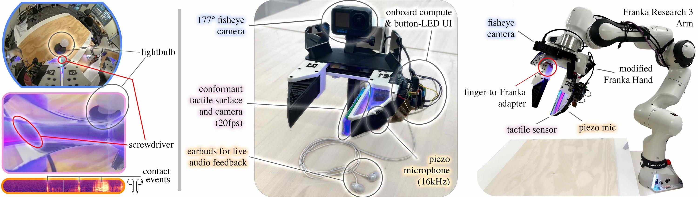</a>
</figure>

> This article is Part 2 of 2 on PolyUMI. Part 1 covers the [hardware, firmware, and data collection system](/projects/polyumi/), and Part 2 covers the training pipeline and deployment journey on our lab's Franka FR3 arm. This is an engineering blog/reference-shaped document focused on technical decisions which were non-obvious or difficult to implement. For a research-oriented view of the system (including lots of evals), you should [check out our preprint & project site!](https://polyumi-vista.github.io/)

---

<figure class="project-figure">
  <a href="#" class="lightbox-img">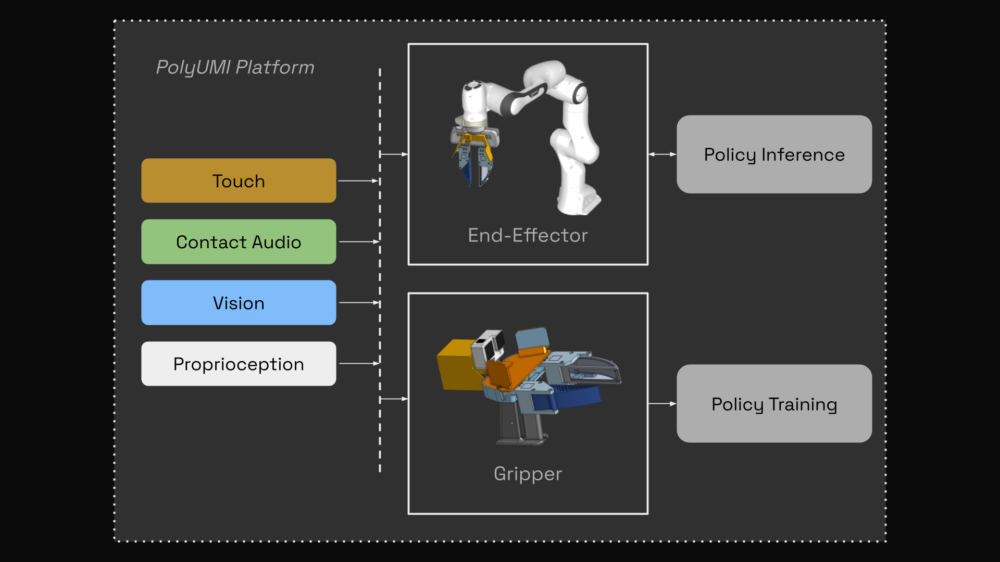</a>
</figure>

TODO high level systems diag

My goal during development was to sprint to a working end-to-end system that was nevertheless modular and well-designed enough to involve other people who could work in parallel. To that latter end, I adopted some architectural changes from prior open source systems. Most significantly, PolyUMI separates the training & inference environment from the robot control stack--policies train and run in a docker container which serves an inference API, while the robot control stack runs on ROS2.

This ended up working out great! This approach not only simplified practical deployments on our lab's hardware (details below), but also made possible a fast-paced remote collaboration between Northwestern CRB and [Pearl Lab (TU Darmstadt)](https://pearl-lab.com/) resulting in [this paper](https://polyumi-vista.github.io) after only 4 weeks of working together; they were free to iterate on model design without needing access to our hardware.

<figure class="project-figure">
  <a href="#" class="lightbox-img">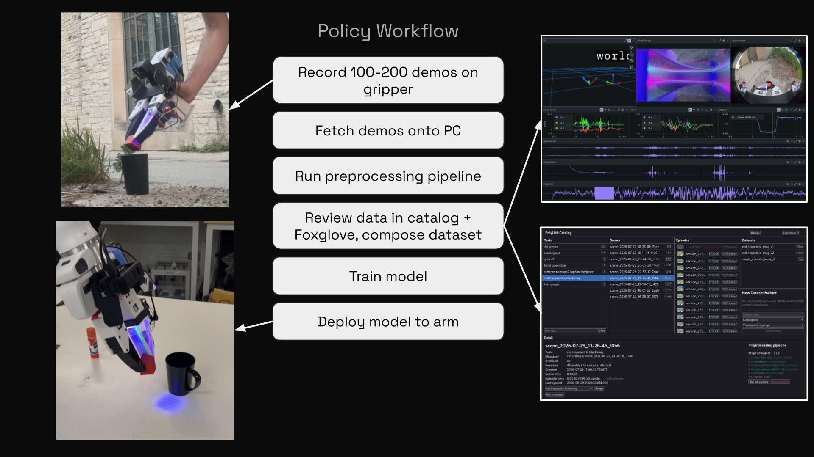</a>
  <figcaption>For the remainder of the article, we will walk through the engineering required to support this workflow for training & deploying a task-specific imitation learning policy with PolyUMI.</figcaption>
</figure>

## Data Pipeline: From Episode Recording to Training-Ready Dataset

### Working Data Format

Recorded sessions are fetched and processed by `pingest`, PolyUMI's preprocessing CLI, into a zarr-based working format (`pzarr`). *This is not a training format, and should not be one.* The needs of training are at-odds
with the needs of preprocessing & dataset maintentance, even for a lightweight research system like this. Unlike a training format, we need our at-rest preprocessing format to be:
- **lossless** (so we can change our model/training algos later & still get maximum use out of old data)
- **incrementally-writable**, and even parallel-writable where possible (to support a multi-step preprocessing pipeline that caches intermediate results. This means we can iterate on one step without having to rerun prior steps, and also incrementally save to disk so a crash doesn't require a full restart)
- **contain all concievable metadata** about what produced each piece of data when (hardware/sensors, preprocessing steps, code versions, etc)

Training and visualization formats -- e.g. `diffusion_policy`-style `ReplayBuffer` subclasses, MCAP, and potentially others -- are lossy but compact downstream artifacts of `pzarr`, and can be generated by `pingest` once preprocessing is complete.

<figure class="project-figure">
  <a href="#" class="lightbox-img">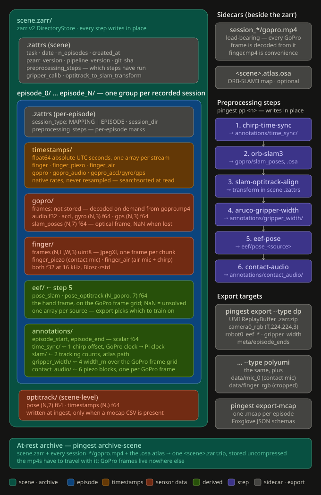</a>
  <figcaption>The <code>pzarr</code> schema: one store per scene, one subgroup per episode, per-stream timestamps at native rates, and pipeline steps writing annotations in place. Sidecars (raw MP4s, SLAM atlas) sit alongside rather than inside. <i>(click for full size)</i></figcaption>
</figure>

**Brief glossary for clarity:**
- Episode -> A single recorded start-to-finish demonstration of a task.
- Scene -> A collection of episodes which were recorded sequentially in a single physical environment. This environment must be consistent across all its episodes, because a single SLAM map is reused across all episodes in a scene.

### Pre-processing Pipeline

<figure class="project-figure">
  <a href="#" class="lightbox-img">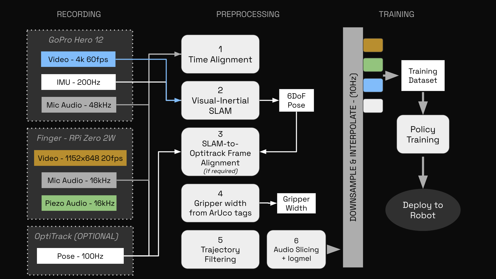</a>
  <figcaption> Overview of the pre-processing stages. <i>(click for full size)</i></figcaption>
</figure>

#### 1. Chirp-based time alignment
The finger camera and mic run on the Pi's clock, the GoPro on its own; we need to figure out how to align data collected across the two devices.
To accomplish this, at the start of each recording the finger emits a linear frequency sweep from an onboard piezo buzzer, captured by acoustic mics on both the finger and the GoPro. A matched filter recovers the chirp onset in both tracks; their difference is the offset between the two clock domains. No hardware sync line is required.

<figure class="project-figure">
  <a href="#" class="lightbox-img">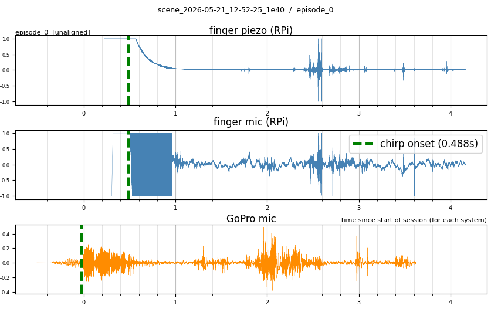</a>
  <figcaption>Step 1. The chirp is located independently in the Pi's air mic and the GoPro's mic; the difference between the two onsets (here 0.488 s) is the offset between the clock domains. The piezo channel is shown on the same axis for reference.</figcaption>
</figure>


#### 2. Visual-inertial SLAM
Following UMI, GoPro video and IMU are run through monocular-inertial SLAM (using PolyUMI's fork of [ORB-SLAM3](https://github.com/cwoodhayes/ORB_SLAM3_PolyUMI)) to recover a 6-DoF gripper trajectory.

The fork contains several small but important changes relative to UMI's fork. The most important of these are:

- **Camera model and calibration.** New settings for the GoPro Hero 12 + Max Lens Mod 2.0, calibrated with [OpenImuCameraCalibrator](https://github.com/urbste/OpenImuCameraCalibrator); UMI's fork targets a Hero 9, which is harder to buy these days.
- **Improved masking of the gripper hardware.** The bottom ~35% of the GoPro's view is the gripper itself. ORB-SLAM doesn't intrinsically know this, and will waste ORB features on the gripper (which provide zero parallax). Our fork masks out the gripper at the pixel level using a PNG mask (see below) to exactly remove the hardware from the view (assuming the fingers stay open). For one example scene, without the improved masking, 498 of 506 two-view reconstructions failed while mapping and 39 of 62 episodes failed to localize; after masking, all but 3 succeeded.
- **ORB features raised to 2500**, and more diagnostic output on tracking failure. Empirically I found this to work better than UMI's settings.

Like UMI, but unlike the original ORB-SLAM3, **we split mapping and localization into 2 separate binaries**. In pre-processing we perform one long mapping pass, then every demonstration episode is localized against that same map to ensure consistency (and save on runtime).

<figure class="project-figure">
  <div style="display: grid; grid-template-columns: repeat(auto-fit, minmax(300px, 1fr)); gap: 1rem;">
    <a href="#" class="lightbox-img">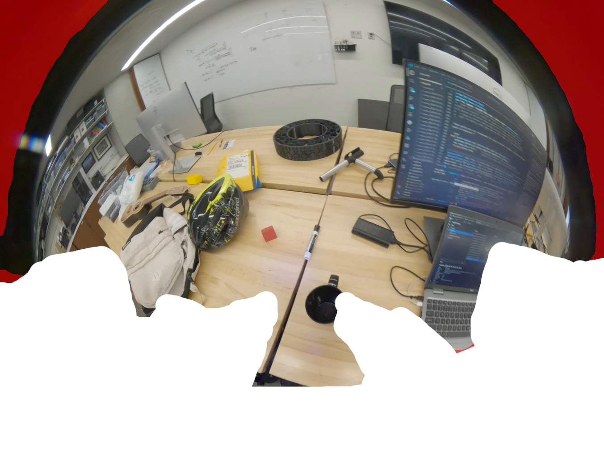</a>
    <a href="#" class="lightbox-img"></a>
  </div>
  <figcaption>PolyUMI's SLAM fork masks out gripper hardware as shown with a PNG mask manually painted on in GIMP.</figcaption>

</figure>

Similar to UMI, I found SLAM's fragility to be probably the biggest drag on my ability to train policies, but still a worthwhile one because by using GoPro SLAM PolyUMI can record data literally anywhere with a single button press, with zero additional hardware.

I experimented with a variety of tweaks to SLAM (and my intern AKA Claude found some small bugs) in addition to the above that didn't make a big difference. One such rabbit hole was experimenting with downsampling to a lower FPS prior to SLAM. This helped a lot with preprocessing speed, but unfortunately I couldn't stop it from degrading performance. I also set up the pipeline to ingest poses from our Optitrack system to have a point of comparison.

**There is a low-hanging fruit here which I did not attempt, but somebody should.** ORB-SLAM3 is causal because it's meant to be run online. We're not running online; we should be able to do a global optimization rather than an online + causal one and get much better performance. There's enough open source UMI projects that this would get a lot of love if somebody put together an acausal UMI slam pacakge.
As a hacky nod to this, I messed around with running ORB-SLAM3 backwards and merging it with the forwards pass; the resulting data was too different for this to help (further supporting the need for an acausal version).


#### 3. SLAM-to-OptiTrack alignment
PolyUMI supports capturing pose data from an OptiTrack motion capture system. This functionality was added primarily to evaluate SLAM performance, but can also be configured to replace SLAM as the pose trajectory source in training datasets.

To enable direct comparison of the SLAM and OptiTrack trajectories (if both are available), an SE(3) transform between the two frames is derived using Horn's method, which is (intuitively speaking) an analytical method for finding optimal alignment between two point clouds:

Given corresponding SLAM/OptiTrack positions $$\{p_i, q_i\}_{i=1}^N$$ with centroids $$\bar p, \bar q$$ and cross-covariance $$H = \sum_i (p_i-\bar p)(q_i-\bar q)^\top = U\Sigma V^\top$$, the rotation and translation minimizing $$\sum_i \|Rp_i + t - q_i\|^2$$ are given in closed form by

$$
R = V\,\mathrm{diag}(1,\,1,\,\det(VU^\top))\,U^\top, \qquad t = \bar q - R\bar p,
$$

with the $$\det(VU^\top)$$ term correcting for reflections so that $$\det R = +1$$.

#### 4. ArUco gripper width
Fiducials on the fingers are detected in the GoPro footage and solved via fisheye-undistorted PnP to give a per-frame width signal. This step follows UMI exactly.

#### 5. Canonical end-effector pose (TCP)

I selected an invisible point immediately between the two fingertips as the control point (TCP) for my policies.
This has many downstream impacts:
- The model predicts a pose trajectory relative to the TCP. Choosing the fingertips (I hope) makes it easy for the model to think about manipulating objects. For instance, say we're trying to grasp the handle of a coffee mug, but we're coming at it from the wrong side. Grabbing from the other side expressed in our TCP frame is nearly a pure rotation. Expressed in the GoPro frame, we'd have to swing along a big arc. **I didn't ablate this decision, and it'd be interesting if someobody did**.
- The impedance controller for the arm places a virtual spring-mass-damper system with the TCP at origin.

Anyhow, regardless of our selection of TCP, at this point in preprocessing, SLAM reports the GoPro's optical frame; OptiTrack reports a marker rigid-body frame. We must translate both into a shared TCP frame. Put another way, UMI policies predict poses relative to the current pose, $$T_0^{-1}T_k$$, from which a shared world frame cancels, but a body-frame offset $$X$$ does not:

$$
\left(T_0 X\right)^{-1}\left(T_k X\right) = X^{-1}\left(T_0^{-1} T_k\right) X
$$

leaving a $$(R - I)x$$ term in the relative translation.

#### 6. Contact-mic audio processing
The 16 kHz piezo signal is sliced into one block per GoPro frame, anchored on each frame's timestamp. This enables sending the audio in the form of log-mel spectrogram images into the downstream model, so that it can be consumed using a vision encoder. This method follows [ManiWAV](https://mani-wav.github.io/).

<figure class="project-figure">
  <div style="display: grid; grid-template-columns: repeat(auto-fit, minmax(300px, 1fr)); gap: 1rem;">
    <a href="#" class="lightbox-img">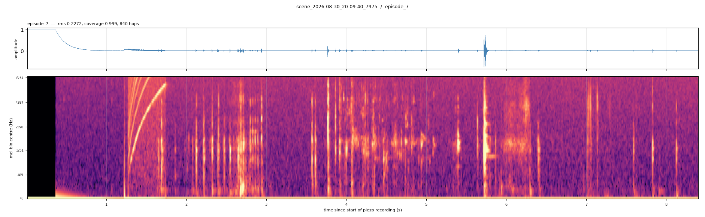</a>
    <a href="#" class="lightbox-img">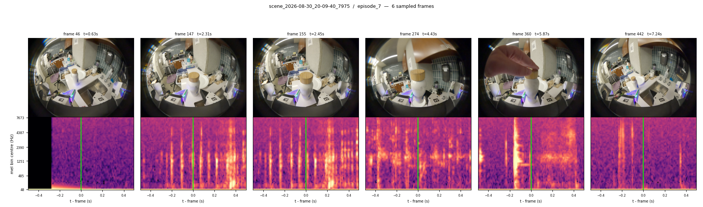</a>
  </div>
  <figcaption>Contact mic waveform sliced into per-frame blocks.</figcaption>

</figure>

### Data organization

<iframe width="560" height="315" src="https://www.youtube.com/embed/TYbPCeTTV2g?si=Dx986_gru-WjNoE0" title="YouTube video player" frameborder="0" allow="accelerometer; autoplay; clipboard-write; encrypted-media; gyroscope; picture-in-picture; web-share" referrerpolicy="strict-origin-when-cross-origin" allowfullscreen></iframe>

A local web UI (`polyumi-catalog`) indexes the recordings directory into SQLite and browses tasks, scenes, sessions, and exported datasets. It also fetches from the Pi, re-runs pipeline steps, and opens episodes in Foxglove. It is a thin layer over the `pingest` CLI utility, which does the real pipeline work. This separation of concerns was great because it let me vibe-code the web app with only some light review, without worrying that I'd compromise the more important pipeline code.

Episodes replay into [Foxglove](https://foxglove.dev/) through an MCAP export, and the end-effector streams live into the same layout during inference.

<figure class="project-figure">
  <div style="display: grid; grid-template-columns: repeat(auto-fit, minmax(300px, 1fr)); gap: 1rem;">
    <a href="#" class="lightbox-img">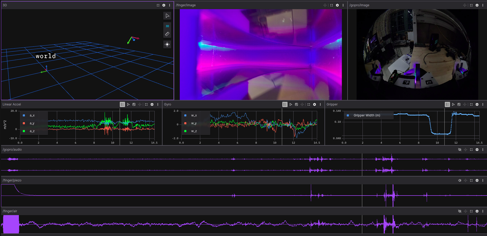</a>
    <a href="#" class="lightbox-img">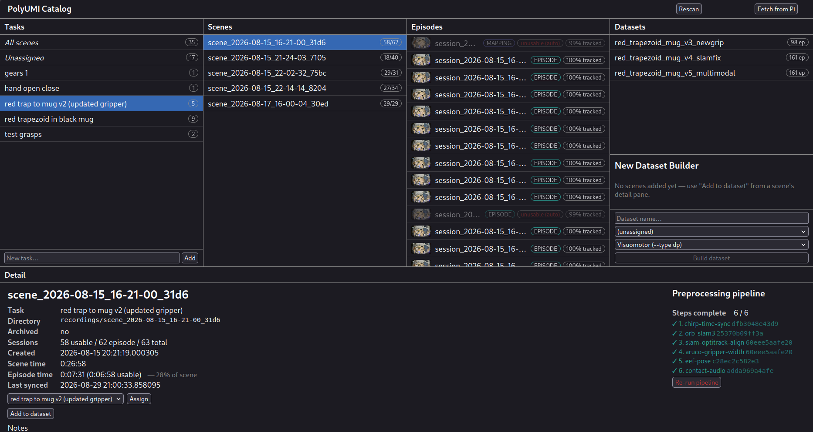</a>
  </div>
  <figcaption>Left: One episode in Foxglove: finger camera, GoPro, IMU, gripper width, and all three audio streams on a common timeline. The chirp is visible at the head of the finger air-mic track. <br/>Right: Catalog UI showing detail on a scene.</figcaption>
</figure>

## Model Training

`pingest export` produces a UMI-compatible `ReplayBuffer` (`.zarr.zip`) that the training code reads directly. Training runs in Docker, since our training environments (here's the baseline visual-only model, forked from [UMI's diffusion policy codebase](https://github.com/real-stanford/universal_manipulation_interface)) need conflicting dependencies vs our control stack in ROS2. The same docker image serves both training and inference: checkpoints are `dill`-pickled and unpickle only against the dependency tree they were trained under. The image builds in two cached stages — the base UMI environment, then the shared inference-protocol networking library — so editing the wire protocol does not rebuild the big training environment.

The first policy brought up end-to-end was visuomotor (vision and proprioception only), to validate the path from data through training and serving to the arm. After the infra was in place, my fantastic collaborator [Rickmer Krohn](https://pearl-lab.com/people/rickmer-krohn/) in Germany was able to develop a variety of multimodal policies for us to try out; on our end, swapping policies was as simple as swapping containers. See our [paper](https://polyumi-vista.github.io) for full details on these models.


## Model Deployment

### Inference system overview

<figure class="project-figure">
  <a href="#" class="lightbox-img">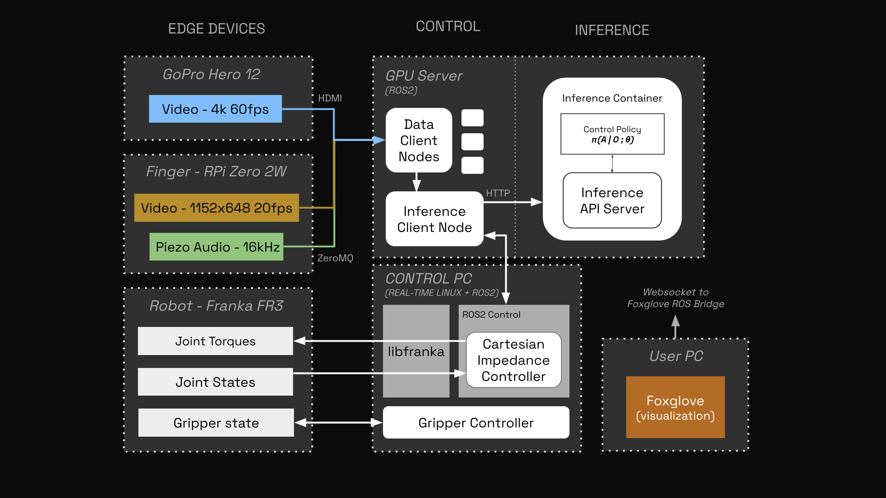</a>
  <figcaption>Software & compute architecture for running a policy on our Franka Research 3 robotic arm.</figcaption>
</figure>

Due to the modular software architecture (ROS2 nodes for control, docker container for model), pieces of the above diagram can be moved to different compute units, but we run as follows for performance.

- **A NUC running RT Linux (Ubuntu)**, which owns the Franka control stack (`ros2_control`, the libfranka hardware interface) and runs the 1 kHz Cartesian impedance controller.
- **A GPU workstation**, which runs the policy container *and* also runs the ROS2 client nodes. This minimizes network latency between model & ROS.
- **The Raspberry Pi Zero 2W** mounted on the gripper publishes tactile & audio data to the GPU workstation's sensor client node over zmq (but does not run ROS itself due to resource constraints)
- **A GoPro** is routed through an ELGATO HDMI Capture Card, then into ROS2 through v4l2 for live video streaming.
- **A laptop**: only for visualization! Reads from Foxglove Bridge over websocket, so it doesn't need ROS and is not on the data path between sensors, model, and arm.

All machines (except the laptop) are synchronized using NTP with `chrony`.
The NUC and workstation communicate over ROS 2, and talk to the pi via zmq (since ROS is too heavyweight to run there). Each machine — including the gripper's Pi — stamps data on its own clock, and drift between them corrupts every derived latency which we use for control. Setting the pi and NUC to sync off of the GPU workstation keeps them in sub-ms agreement.

The arm's gripper is a Franka Hand modified for low latency & continuous position control, affectionately referred to as the FrankenHand (see repo maintained by Northwestern CRB [here](https://github.com/cwoodhayes/polyumi_diffusion_policy)).

TODO correctly link the Anunth's repo.

> **PLACEHOLDER — diagram:** network and timing architecture across the four machines (Pi, laptop, NUC, GPU workstation), annotated with the chrony hierarchy and CycloneDDS domain boundaries.

### Control: the Cartesian impedance controller

PolyUMI follows the two-layer hierarchy standard for this setting: the policy emits an action chunk of absolutely-timed end-effector waypoints at roughly 10 Hz, and a real-time controller tracks it at 1 kHz. The controller is a port of [SERL's Franka impedance controller](https://github.com/rail-berkeley/serl_franka_controllers) ([paper](https://arxiv.org/abs/2401.16013)), itself derived from `franka_ros`'s reference implementation, and closely related to the law UMI runs on its own stack.

TODO link my own repo rather than theirs above^

Given:
- measured joint state $$(q, \dot{q})$$
- base-frame Jacobian $$J \in \mathbb{R}^{6\times7}$$
- and a reference pose from the interpolator,

the pose error $$e \in \mathbb{R}^6$$ stacks the translation error with the vector part of the difference quaternion, hemisphere-corrected and rotated into the base frame. The commanded torque is

$$
\tau = J^\top\left(-K\bar{e} - D\,J\dot{q} - K_i e_I\right) + \left(I_7 - J^\top \left(J^\top\right)^{+}_{\lambda}\right)\left[K_n\left(q_n - q\right) - 2\sqrt{K_n}\,\dot{q}\right]
$$

where $$\bar{e}$$ is the per-axis clipped error and the second term resolves the arm's redundant seventh DOF through a damped pseudo-inverse ($$\lambda = 0.2$$). Joint 1 takes a stiffer nullspace tier (100 against 0.2) so elbow rotation is preferred over base rotation. $$K_i$$ is zero in our configuration, following SERL (and common sense, since integral terms can easily make your controller unstable). The result is rate-limited against the previous commanded torque at 1 Nm per cycle, which `libfranka` requires.

| Parameter | Value | |
|---|---|---|
| $$K_{\mathrm{trans}}$$ / $$D_{\mathrm{trans}}$$ | 2000 N/m / 89 Ns/m | $$D \approx 2\sqrt{K}$$, critically damped |
| $$K_{\mathrm{rot}}$$ / $$D_{\mathrm{rot}}$$ | 150 Nm/rad / 7 Nms/rad | under-damped, as in SERL and UMI |
| $$c_{\mathrm{trans}}$$ / $$c_{\mathrm{rot}}$$ | 0.01 m / 0.05 rad | error clip |
| $$K_n$$ / $$K_{n,1}$$ | 0.2 / 100 | nullspace |

Bounding interaction force is extremely helpful for contact-rich tasks (so you don't crush stuff or smash through a table), but lowering stiffness to achieve it costs tracking accuracy in free space. Following SERL, the error is instead clipped at the real-time layer, which caps commanded force at $$K_{\mathrm{trans}} c_{\mathrm{trans}} = 20$$ N regardless of how far the reference has run from the measured pose — a stalled chunk and a policy commanding a pose inside the table produce the same bounded push. UMI's spring is softer (750 N/m) but unbounded. On a cobot that's at least still _safe_, but with a clip you can avoid firing the arm's collision thresholds and just be always gentle with the world instead.

The interpolator is a C++ port of UMI's `PoseTrajectoryInterpolator`: piecewise-linear in position, slerp in orientation, over absolutely-timed waypoints. It merges an arriving chunk into the trajectory already being consumed, without discontinuity at the current instant — which is what allows 10 Hz chunks to drive a 1khz loop. Waypoint speed is capped at 1.0 m/s and $$\pi$$ rad/s.

Finally, the policy's body frame is the fingertip midpoint, while the arm reports its Jacobian roughly 15 cm away at the hand frame, so the Jacobian is shifted onto the TCP column-wise, $$J_{v,i} \leftarrow J_{v,i} + J_{\omega,i} \times r$$, with the angular rows unchanged.

> **PLACEHOLDER — diagram:** control block diagram — action chunk → interpolator (with speed clamps) → pose error → clip → impedance law + nullspace projection → torque-rate saturation → FCI, with the 10 Hz / 1 kHz rate boundary marked.

### Latency and synchronization

My feeling is that engineering difficulties posed by latency grow geometrically with number of sensory inputs. Maybe also with number of compute nodes.

You see, in our training data, we work hard to ensure that every datastream is synchronized to the GoPro frame grid by our preprocessing pipeline; in other words, an observation is a nice collection of measurements all taken at the same instant. On the robot nothing is naturally synchronized; all sensors have different latencies which vary at runtime and are measured on multiple different clocks, due to the distributed nature of the system. There's several approaches to dealing with this, but they all divide some responsibility between the system and the model to compensate for latency & unsynced signals.

In our case, we took the approach of "use system tricks to convert misalignment to latency, then have the model learn to predict the future to compensate for the latency". We source each observation from the instant at which the oldest measurement in the sensor set was taken (interpolating samples from the history of the other sensors as necessary). This means we're basically stuck at the latency of the slowest sensor, which is a big motivator for speeding up the sensor processing pipelines, and it also means we have to build a good model of the latencies in the system to get good guesses as to when measurements were actually taken on a shared clock.

To do this, we:
1. measure as much as we can online, per inference call
2. model what we can't measure online via offline experiments

```
photon ──(latency.gopro)──> header.stamp ──(measured live)──> response ──(latency.arm_exec)──> motion
        CALIBRATE                          nothing to do                 CALIBRATE
```

`header.stamp` is the earliest instant the client can observe. Everything after it — color conversion, tick phasing, the POST, the network, the forward pass — is measured on every tick and converted directly into a count of leading actions to discard. Everything before it is calibrated offline: camera latency by filming a QR-encoded clock and differencing against the frame's stamp (UMI measures 0.125–0.17 s on the same GoPro-to-capture-card chain), arm execution latency by chirping the commanded pose and cross-correlating against where the TCP actually went. Proprioception latency is adopted rather than measured, at ~1 ms; isolating it would need external ground truth of the true pose, and UMI hardcodes the same constant for the same reason.

Latency at inference time forces the model to predict further out into the future, since we handle the latency by skipping the first n steps from the action chunk s.t. `n/step_freq_hz == T_latency`.

The binding constraint is that the chunk must outlast the latency budget:

$$
t_{\mathrm{obs\ age}} + t_{\mathrm{exec}} < n_{\mathrm{action\ steps}} \cdot \Delta t_{\mathrm{action}}
$$

If it does not hold, every action has already elapsed on arrival and the arm does not move at all, while every other indicator reads healthy.

> **PLACEHOLDER — diagram:** end-to-end latency diagram, photon to motion, with each calibrated/measured/adopted segment labeled.

> **PLACEHOLDER — screenshot:** Foxglove latency-monitor plot during a live rollout.

## Evaluation

Evaluation is in progress and is the subject of an upcoming publication. Planned ablations target which modalities contribute under which conditions — in particular whether the contact mic supplies only a binary contact signal or also discriminates materials and state changes. The evaluation tasks are chosen to stress what camera-only imitation struggles with: contact-rich dexterous tasks (pipetting, threading a lid), dynamic tasks infeasible to teleoperate (tossing an object into a bin), and conditions that degrade one modality, such as lighting changes during a rollout.

> **PLACEHOLDER:** evaluation results — success rates per task and per ablation.

## Lessons Learned

Lessons learned from bringing up a UMI system (no particular order):
1. Latency is perhaps the hardest problem to solve at inference. the lower the total latency, the less the model has to predict the future. difficulty scales with:
	1. number of modalities (i have 4)
	2. number of compute nodes (at inference, I have 4, simplified down from 3. At data collection time, I have 4)
	3. nondeterminism (use wired connections where possible, etc)
		1. Measure what you can at runtime
		2. Calibrate out what you can't using offline testing procedures
		3. Try to reduce mean + stdev as much as possible
2. Naive data collection is an ideal, not a reality
	1. There are tricks to collecting good UMI policies -- fully non-expert operators + fully embodiment-agnostic data collection isn't realistic (at this data scale + system performance)
		1. Embodiment specific needs:
			1. Collect trajectories that respect the kinematics of the arm (ie workspace limits, don't bottom out onto table, avoid joint singularities)
		2. Need to move deliberately enough so that your policy's control frequency can capture the important moments for your task -- especially contact rich ones. Unlike teleop, a umi policy can collect *really fast trajectories* and deploy them onto the arm--this doesn't mean that you *should* do this, because these often perform worse
		3. Good SLAM performance is essential and very hard to achieve with existing open source tools. I made some minor tweaks to ORB-SLAM3 which helped, but still, this step fails quite often, making that data unusable. An open source alternative for UMI-type projects could achieve significantly improvement over existing options just by being non-causal from the start (since you don't need real-time results, it's mostly a SfM problem).
	2. Limiting the operator's haptic & sensory feedback to what the gripper can record (even if just in imagination) is very helpful. Think through how the signals you have can help the model understand your task, and perform the task accordingly
	3. Still much more expressive than teleop!
		1. Stuff that gives you more expressiveness (given a policy & a set of modalities)
			1. Improved hardware performance (mechanism design)
			2. High system performance (low latency, high fidelity)
3. Control architecture is the unpublished "secret sauce"
	1. Arm:
		1. well-tuned, fast cartesian impedance controller for soft handling
		2. trajectory interpolation + merging scheme is very important (since action chunks will not always agree & they overlap). Temporal ensembling (added after the videos above were taken) improved the jitteriness of the trajectory significantly
	2. Gripper:
		1. real-time control required (note on Franka Hand -- we had to take apart the hand and modify it to work real-time)
4. Need to think through how to decrease domain gap between gripper & end-effector from day one in design phase. Need to iterate full-stack to improve this
	1. Examples:
		1. Audio noise improvement -- embedded mic, gear tolerance tightening (show difference)
		2. Side window vs no side window
		3. Sensing surface improvement
5. Data organization & visualization is key (ie catalog ui, foxglove, jupyter notebooks, etc)
	1. You will need a way to prune out bad episodes from your dataset etc
	2. Make data collection easy (good gripper design) pays dividends in policy & task development + performance (due to more expressive behavior capture). In-the-wild data, etc
	3. Need to have an intuitive understanding of the system's performance, beyond just abstract. Your intuition is most powerful instrument for debugging, need to supply it with data. LLM's are incredible at symbolic reasoning and can help you with bugs of that nature; but they usually can't do this system-level thinking and physical intuition. Figure out a way to make your problems obvious visually, auditorially, use all your senses to understand the system and the problem.

Biggest takeaway:
- Getting a UMI-based imitation learning policy working requires a significant investment in systems & infrastructure, and each modality makes it harder. Don't throw this away & don't understimate the effort. Need to get the system performing *really well* in a good old fashioned engineering sense before model improvements even make a difference.

My timeline (roughly):
- 2months hardware + systems design & bringup (getting data signals in)
- 1 month firmware + data organization
- 2 months preprocessing
- 2 months inference system bringup (1 month of which is latency + control optimizations to get to first near task success)
- 1 month full-system iteration


---

## Citation

{% include citation.html bibtex="@misc{hayes2026polyumiaccessiblevisualtactileaudiodata,
      title={PolyUMI: Accessible Visual-Tactile-Audio Data Collection for Object Inference and Manipulation},
      author={Conor W. Hayes and Rickmer Krohn and Aravind Ramaswami and Anunth Ramaswami and Nils Dengler and Kevin M. Lynch and J. Edward Colgate and Georgia Chalvatzaki and Matthew L. Elwin},
      year={2026},
      eprint={2609.29760},
      archivePrefix={arXiv},
      primaryClass={cs.RO},
      url={https://arxiv.org/abs/2609.29760},
}" %}
